# Awesome-Autonomous-Revenue-Operations 📈 ⚙️

  

  
  
  
  
  
  

---

## 🌟 Top Autonomous Revenue Operations Ecosystem

**Curated List of Commercial RevOps Platforms & Open-Source Revenue Intelligence Tools**  

*Focused on Pipeline Analytics, Forecast Accuracy, Activity Capture, Deal Intelligence, CRM Hygiene & Self-Hosted Revenue Operations*

**Last updated: October 2026** 📅

---

### 📌 Overview & SEO Summary

Welcome to the ultimate curated directory of **autonomous revenue operations platforms**, **open-source revenue intelligence tools**, and **sales analytics frameworks**. Whether you are looking for enterprise-grade commercial solutions (such as *Clari*, *Gong*, and *Salesforce Revenue Cloud*), or self-hostable open-source alternatives (like *OpenCloser*, *Radiant AI CRM*, and *Twenty*), this list covers category leaders, pipeline analytics, and privacy-respecting revenue operations.

**Key Market Context:**

- **Salesforce leads the 2026 ISG Revenue Intelligence Buyers Guide** with an overall score of **82.0%**, followed by **Gong (79.0%)** and **Salesloft (78.2%)** — **Gong, Outreach, Salesforce, and Salesloft** were rated **Exemplary**, with **Aviso and Clari** rated **Innovative** .

- **Salesforce Agentforce Revenue Cloud** introduced **Intelligent Quote Builder** in Spring 2026, using AI to **auto-generate quotes and proposals**, create **product bundles**, and apply **volume discounts** — alongside **Revenue Cloud Advanced** with better MCE support and usage-based selling .

- **Clari Forecast is now quote-only on annual contracts** after the Salesloft merger in September 2026, and is **best fit for organizations with a dedicated revenue operations function** .

- **Gong is the conversation intelligence leader** for mid-market and enterprise, with **5,000+ companies** using its platform to record calls, surface deal risks, and auto-populate CRM .

- **People.ai** automates **CRM data hygiene** by capturing activity from email, calendar, and calls, then using AI to ensure the CRM is complete and accurate .

- **Syncari** is a **no-code data unification platform** that syncs activity data across CRM, marketing, and support systems, eliminating manual data entry and reconciliation .

- **OpenCloser** is the **most complete open-source AI SDR & revenue operations platform** — with **AI Sales Strategist, Lead Researcher, AI Caller (SDR), Sales Coach, and Sales Manager** all running locally with zero cloud dependency .

- **Radiant AI CRM** connects to email and calendar via **Nylas**, analyzes every activity, joins meetings, and drafts next-best-actions — the **only open-source AI CRM that works autonomously in the background** .

---

## 📑 Table of Contents

- [🏢 SaaS & Commercial Platforms](#-saas--commercial-platforms)

- [🔓 Open-Source GitHub Projects](#-open-source-github-projects)

- [🛠️ How to Contribute](#%EF%B8%8F-how-to-contribute)

- [📊 Star History](#-star-history)

- [🤝 Support & Sponsorship](#-support--sponsorship)

- [⚠️ Disclaimer](#%EF%B8%8F-disclaimer)

---

## 🏢 SaaS / Commercial Platforms

> **Market Analysis & Size**: The global Revenue Operations (RevOps) and Revenue Intelligence market is estimated at **$4.4B – $6.2B in 2024–2025** and projected to surpass **$17B – $21B by 2032–2033** (CAGR ~16–18%). The sector is currently **highly to moderately fragmented** rather than winner-take-all; despite CRM behemoths like Salesforce providing core infrastructure, specialized intelligence platforms, conversation analyzers, and data sync engines coexist as enterprises compose multi-vendor best-of-breed revenue stacks.

| SaaS / Commercial Platform | Company / Owner | Company Size (Valuation / Revenue) | Standard Starting Price | Free Tier / Free Trial Limits | Description |
| :--- | :--- | :--- | :--- | :--- | :--- |
| **[Salesforce Agentforce Revenue Operations](https://www.salesforce.com/)** ☁️ | Salesforce | ~$250B Market Cap (~$38B ARR) | **$150/user/month** (Growth Edition; $200/user/mo Advanced, or CPQ add-on from $75/user/mo) | **Free tier via Salesforce Foundations with 100,000–200,000 Flex Credits** (20 Flex Credits per agent action); 30-day trial for Sales/Revenue Cloud | **CRM-native revenue operations** — **Intelligent Quote Builder auto-generates quotes and proposals, creates product bundles, and applies volume discounts** . **Revenue Cloud Advanced with better MCE support and usage-based selling** . **ISG 2026 Revenue Intelligence Leader (82.0%)** . |
| **[Gong](https://www.gong.io/)** 🎯 | Gong | ~$4.5B Valuation (~$500M ARR) | **$108/user/month** ($1,300/user/year base license; +$5,000/year minimum platform fee) | **No free-for-ever tier; No public self-serve trial** (Sales-assisted 14-day guided pilot/POC available upon demo qualification) | **Revenue intelligence leader** — **Records every sales call, surfaces deal risks, and auto-populates CRM from conversation data** . **Used by 5,000+ companies** . **Rated Exemplary in ISG 2026** . **Strongest for conversation intelligence and deal coaching** . |
| **[Clari](https://www.clari.com/)** 🔷 | Salesloft / Vista | ~$2.6B Valuation (~$200M ARR) | **$100/user/month** ($1,200/user/year base tier; annual contract required, typical ACV $25k+) | **No free-for-ever tier; No public trial** (Custom guided proof-of-concept for qualified enterprise revops teams via demo) | **Enterprise revenue operations** — **Builds forecast from system signals rather than figures reps type into CRM** . **Pipeline analytics, AI forecast predictions, deal inspection, and forecast variance tracking** . **Best fit for organizations with a dedicated revenue operations function** . **Rated Innovative in ISG 2026** . |
| **[People.ai](https://people.ai/)** 📊 | People.ai | ~$1.1B Valuation (~$63M ARR) | **$50/user/month** (Base activity capture module; enterprise bundles scale to $100+/user/month) | **No free-for-ever tier; No self-serve trial** (Sales-led enterprise pilot with sandbox evaluation available post-demo) | **Revenue operations platform** — **Automatic activity capture from email, calendar, and calls** . **AI-powered CRM hygiene ensures data is complete and accurate** . **Contact and account insights for pipeline intelligence** . |
| **[Mediafly](https://www.mediafly.com/)** 🟠 | Mediafly | ~$131M Raised (~$17.2M ARR) | **$30/user/month** (Essential edition starting rate; modular enterprise tiers quoted annually) | **No free-for-ever tier; No self-serve trial** (Guided Content Outcome Assessment / custom pilot via demo) | **Revenue enablement platform** — **Content management, buyer engagement, and revenue intelligence** . |
| **[Syncari](https://syncari.com/)** 🔄 | Syncari | ~$50M–$100M Valuation (~$26.8M Raised) | **$2,500/month** (Standard plan covering 20,000 synced unified records across connected systems) | **14-day free trial** (Full platform "Test Drive" with preconfigured datasets and multi-system sync sandbox) | **Data unification platform** — **Syncs activity data across CRM, marketing, and support systems** . **No-code sync pipelines eliminate manual data entry** . |
| **[Aviso](https://www.aviso.com/)** 🔵 | Aviso | ~$46M–$60M Raised (~$37M ARR) | **$108/user/month** ($1,300/user/year starting tier for predictive forecasting; annual commitment) | **No free-for-ever tier; No public trial** (Guided 30-day proof-of-value sandbox for enterprise sales teams upon demo) | **AI revenue intelligence** — **Forecasting and pipeline management** . **Rated Innovative in ISG 2026** . |
| **[Revenue.io](https://www.revenue.io/)** 🟣 | Revenue.io | ~$44.5M Raised (~$11.8M ARR) | **$75/user/month** (Activate tier; $125/user/month for Engage, $175/user/month for Orchestrate) | **Free tier available for Revenue Roleplay with 100 AI roleplay sessions**; Enterprise suite has 14-day guided trial | **Revenue operations platform** — **Conversation intelligence and forecasting** . **Rated Assurance in ISG 2026** . |
| **[BoostUp.ai](https://www.boostup.ai/)** 🟢 | Terret (BoostUp) | ~$40.8M Raised (~$15M ARR) | **$79/user/month** (Standard pipeline & forecast intelligence module; billed annually) | **No free-for-ever tier; No public trial** (14-day sales-assisted evaluation pilot available upon demo) | **Revenue operations and forecasting** — **Pipeline intelligence, forecast accuracy, and deal inspection** . |
| **[InsightSquared](https://www.insightsquared.com/)** 🔴 | Mediafly | Acquired by Mediafly (~$131M Total Raised) | **$65/user/month** (Starter RevOps & pipeline analytics edition; annual contract) | **No free-for-ever tier; No public trial** (Custom guided proof-of-concept for qualified sales teams via demo) | **Revenue intelligence** — **Pipeline analytics, forecasting, and conversation intelligence** . **Part of Mediafly** . |

---

## 🔓 Open-Source GitHub Projects

*Curated list of self-hostable CRMs, AI SDR callers, autonomous revenue operations engines, and billing workflows — sorted by GitHub_Stars_Count (Descending)* 🌟

- **[Twenty](https://github.com/twentyhq/twenty)**  ⚡  
  **Modern open-source CRM with the flexibility of code**, AGPL-3.0 licensed. **The #1 open alternative to Salesforce and HubSpot** designed for modern engineering and RevOps teams. Features full pipeline management, custom database objects, GraphQL/REST APIs, self-hosting via Docker/Helm, and native AI automation workflows. **TypeScript, NestJS, React, and PostgreSQL**. 🚀

- **[Cal.com](https://github.com/calcom/cal.diy)**  📅  
  **Open-source scheduling infrastructure for revenue operations**, AGPL-3.0 licensed. Eliminates booking friction in sales pipelines with round-robin lead routing, automated CRM qualification handoffs, payment gate integrations (Stripe), and deep webhooks into revops data pipelines. ⏱️

- **[PostHog](https://github.com/PostHog/posthog)**  🦔  
  **Open-source product analytics, revenue attribution & customer data platform**, MIT licensed. Powers product-led sales (PLS) and autonomous RevOps with self-hosted product analytics, session replay, customer event tracking, feature flags, and revenue cohort analysis for sales ops. 📈

- **[Chatwoot](https://github.com/chatwoot/chatwoot)**  💬  
  **Open-source omnichannel customer communication & conversation intelligence**, AGPL-3.0 licensed. An open-source alternative to Intercom, Zendesk, and Salesforce Service Cloud. Consolidates inbound sales conversations across Live Chat, WhatsApp, Email, SMS, and Twitter into a unified team inbox with CRM sync. 🔥

- **[Krayin CRM](https://github.com/krayin/laravel-crm)**  🛠️  
  **Free & open-source CRM built on Laravel for enterprise lead & sales management**, MIT licensed. Designed for businesses seeking complete data control and rapid customization. Includes lead routing, Kanban deal stages, multi-channel customer tracking, access control, and modular enterprise expansion. 💼

- **[Documenso](https://github.com/documenso/documenso)**  ✍️  
  **The open-source DocuSign alternative for sales contracts & closing deals**, AGPL-3.0 licensed. Automates quote-to-cash signature workflows, enterprise NDA signing, mutual closing agreements, and webhook-driven contract reconciliation in modern revenue pipelines. 📄

- **[Mautic](https://github.com/mautic/mautic)**  🎯  
  **Open-source marketing automation & lead scoring engine**, GPL-3.0 licensed. Automates inbound demand generation, dynamic lead qualification scoring, multi-touch email nurturing campaigns, and automated handoffs to sales pipelines. 📬

- **[Invoice Ninja](https://github.com/invoiceninja/invoiceninja)**  💰  
  **Open-source invoicing, quotes, payments, and revenue collection platform**, Elastic License / AGPL-3.0. Powers quote-to-cash workflows for revenue teams: auto-generates quotes, tracks approvals, issues recurring invoices, and monitors payment reconciliation with multiple payment gateways. 💳

- **[Crater](https://github.com/crater-invoice-inc/crater)**  🧾  
  **Open-source invoicing & estimate management solution**, AGPL-3.0 licensed. Built on Laravel and Vue.js for SMB revenue teams to design, send, and track estimates, expenses, and payments with zero third-party platform lock-in. 💵

- **[SuiteCRM](https://github.com/SuiteCRM/SuiteCRM)**  🏛️  
  **Award-winning enterprise-class open-source CRM**, AGPL-3.0 licensed. The battle-tested successor to SugarCRM Community Edition. Includes complex workflow automation, quotes, contracts, enterprise role management, and complete revenue reporting. 🏢

- **[Kill Bill](https://github.com/killbill/killbill)**  💳  
  **Open-source subscription billing & payment engine for RevOps**, Apache-2.0 licensed. Enterprise-grade recurring billing engine that scales subscription lifecycle management, usage-based billing, payment routing, and invoice reconciliation with multi-gateway redundancy. ⚡

- **[Frappe CRM](https://github.com/frappe/crm)**  🚀  
  **Fully featured, modern open-source CRM**, MIT licensed. Built on the Frappe framework with a Python backend and Vue.js frontend. Seamlessly connects pipeline management, lead scoring, and customer communication with ERPNext's financial and ERP ecosystem. 📊

- **[EspoCRM](https://github.com/espocrm/espocrm)**  🎯  
  **Lightweight open-source CRM with SPA frontend and REST API**, AGPL-3.0 licensed. Features deep email sync, automated business process workflows (BPM), sales pipeline analytics, and fine-grained role-based access control for SMBs. 📋

- **[Django-CRM](https://github.com/Django-CRM/Django-CRM)**  🐍  
  **Open-source analytical CRM for startups with pipeline management**, MIT licensed. Django and SvelteKit architecture supporting multi-tenant deployments, deal stage tracking, task management, and programmatic sales automation. 💻

- **[Warmbly](https://github.com/warmbly/warmbly)**  🛡️  
  **Open-source B2B cold outreach & email warmup service**, open-source. Runs cold email campaigns from mailboxes you already own and warms them to maintain high deliverability. Multi-step sequences, unified inbox, and automated reply playbooks. ✉️

- **[SDRbot](https://github.com/NForce-ai/SDRbot)**  🤖  
  **Open-source, terminal-native RevOps agent**, open-source. Automates CRM tasks, prospect research, and sales outreach workflows using your own API keys. Features interactive TUI commands, MCP server interoperability, and SQLite session persistence. 💻

- **[Radiant AI CRM](https://github.com/dylanmeyford/radiant-ai-crm-oss)**  🧠  
  **Open-source AI CRM that operates autonomously in the background**, open-source. Connects to email and calendar via Nylas, automatically ingests activity data, attends/analyzes meetings, updates deal records, and drafts next-best actions. 🤖

- **[OpenCloser](https://github.com/issacops/opencloser)**  🎙️  
  **Open-source AI SDR & local autonomous RevOps engine**, MIT licensed. Features an AI Sales Strategist, autonomous lead hunter with ICP scoring, and an AI Voice Caller powered by Google Gemini/Twilio with live transcription, sentiment tracking, and objection sparring training. 🚀

---

## 🛠️ How to Contribute

Contributions are welcome! Follow these steps to submit new autonomous revenue operations platforms, AI SDR tools, or open-source revenue intelligence repositories:

1. 🍴 **Fork** the repository.
2. 📝 **Add/edit** entries in `README.md` maintaining table/list structure and formatting.
3. 🔗 Include project title, official website/GitHub link, exact Stars_Count, license, and concise description.
4. 🚀 Submit a **Pull Request** with a descriptive summary of your changes.

---

## 📊 Star History

---

## 🤝 Support & Sponsorship

If you find this autonomous revenue operations repository useful, please consider supporting the project:

- ⭐ **Star** this repository to increase visibility!
- 🔀 **Fork** and share with fellow revenue operations leaders, sales analysts, and open-source RevOps advocates.
- ☕ **Sponsor & Buy Me a Coffee**: Support ongoing open-source curation via the [GitHub Sponsor Dashboard](https://github.com/sponsors/ishandutta2007).

---

## ⚠️ Disclaimer

- This is a **community-curated** list — not exhaustive and not an endorsement. ℹ️
- **Salesforce leads the 2026 ISG Revenue Intelligence Buyers Guide** with **82.0% overall**, followed by **Gong (79.0%)** and **Salesloft (78.2%)**. **Gong, Outreach, Salesforce, and Salesloft** were rated **Exemplary**, with **Aviso and Clari** rated **Innovative**.
- **Salesforce Agentforce Revenue Cloud** introduced **Intelligent Quote Builder** in Spring 2026 — AI auto-generates quotes and proposals, creates product bundles, and applies volume discounts.
- **Clari Forecast is quote-only on annual contracts** after the Salesloft merger — best fit for organizations with a dedicated revenue operations function. **Gong is used by 5,000+ companies** for conversation intelligence and deal coaching.
- **Open-source revenue operations tools are not turnkey** — self-hosted CRMs and AI agents require infrastructure and API key configurations. Always validate pipeline hygiene and data security with a proof-of-concept before production deployment. 📈

---

  <b>Made with ❤️ for revenue operations leaders, sales analysts, and open-source RevOps advocates.</b>

